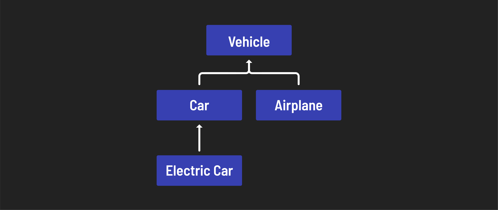

<h1>
  Intro to OOP with Java
  Object-Oriented Programming Paradigm
</h1>

**Learning objective:** By the end of this lesson, you'll be able to describe the object-oriented programming (OOP) paradigm.

## Why OOP emerged

In the early days of computing, programming was mostly **procedural**. Instructions were written sequentially, with data and logic closely intertwined. While effective for small programs, this method became increasingly unwieldy as software systems grew in size and complexity.

Imagine trying to debug or find the root cause of an error in a hospital management system with over a million lines of code in a single, massive procedural codebase. Changing one line of the code could cause downstream statements to fail. There would be no way to predict that failure because of the size and complexity of the program.

Programmers needed a way to organize and simplify their work while still capturing the nuances of real-world problems.

## The object-oriented paradigm

Object-orient paradigm is a way of designing and writing computer programs by thinking of any software requirement as a problem to solve by organizing the interactions between self-contained entities, called **Objects**, efficiently and effectively. These objects possess:

- **Properties**: Data values that describe what they are.
- **Methods**: Labeled actions that describe what they can do.

When a task needs to be accomplished, all it takes is identifying the most appropriate object, using its properties, passing the required data to it, and instructing it to perform the action (method) that can accomplish the task. Programming an entire application is, then, viewed as orchestrating such interactions between objects towards a larger purpose.

## The four pillars of OOP

How can we tell if a programming language is object-oriented or procedural? The answer is that OOP languages demonstrate all four following characteristics by design, whereas procedural languages do not. Let's look at each of them with a real-world analogy.

### Abstraction

The idea behind abstraction is that the average person doesn't need to know the inner workings of something to use it successfully. For example, you don't have to be a mechanic to drive a car.

Abstraction allows developers to focus on their code at a higher level without worrying about the internals of how the class itself functions.

### Encapsulation

Encapsulation is the bundling of data and the methods that operate on that data into a single object.

Encapsulation is also related to abstraction but goes a step further. Not only does the average user not need access to the inner workings of something to use it, but it may actually be harmful if they do have access.

You could technically start your car with a screwdriver or directly with electricity, but you really shouldn't — you might hurt yourself or damage your vehicle. Likewise, your users don't always need direct access to sensitive parts of your code.

Encapsulation ensures that when you interact with an object's data, it's done in a safe and controlled manner.

### Inheritance

Inheritance allows classes to acquire code from one another. The base class is called the **parent**, and the inheritor or beneficiary class is called the **child**.

The most frequent use of inheritance is for deriving classes using existing classes, which provides reusability. The existing classes remain unchanged. By promoting reusability in our code, the development time of software is reduced.

Inheritance creates a hierarchy between classes, where data and behavior flow from ancestors to descendants.

### Polymorphism

Polymorphism comes from the Greek words *poly* (meaning "many") and *morph* (meaning "forms"). It refers to the fact that a method could have multiple implementations, either differing between a parent and a child class (method overriding) or depending on the type and number of arguments (method overloading).

As a real-world analogy, consider an electrical switch that can be turned on and off. A switch can be made to control any connected electrical device, depending on what it's connected to, without changing the structure or functionality of the switch.

In short, polymorphism makes it easier to implement new functionality without changing existing code.

## Thinking in an object-oriented way

For many, OOP is a more natural way to view applications as there are many connections with how the real world works. We know how to do it instinctively. However, to most effectively utilize OOP, some may need to unlearn a more procedural or functional way of thinking.

| Feature           | Procedural paradigm                                                                                                | Object-oriented paradigm                                                                                                                                  |
| :---------------- | :----------------------------------------------------------------------------------------------------------------- | :-------------------------------------------------------------------------------------------------------------------------------------------------------- |
| **Data handling** | Data and logic are individual entities capable of existing independently.                                          | Data and logic are always encapsulated into a single entity, and that entity is represented as an object.                                                 |
| **Code reuse**    | Reusable at the level of functions.                                                                                | Reusable at the level of objects through inheritance and polymorphism.                                                                                    |
| **Point of view** | A computer program is a simple sequence of procedures and processes manipulating data values to achieve a purpose. | A computer program is an orchestrated set of interactions between objects to achieve a purpose. There's no limit to the complexity of such orchestration. |
