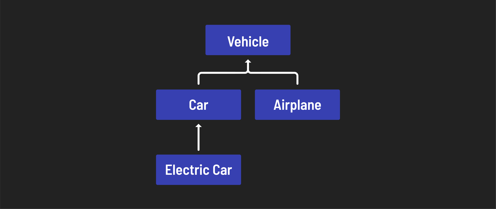

<h1>
  Intro to OOP with Java
  The Four Principles of OOP
</h1>

**Learning objective:** By the end of this lesson, students will be able to define the four principles of object-oriented programming.

## Concepts

**Object-oriented programming**, or OOP, is a concept that was first introduced in the 1960s with the advent of the Simula programming language and became popular some 25 years later with C++.

Whereas earlier languages were **procedural**, object-oriented programming introduced the concept of **objects** — compartments of data and functionality that could easily retain and modify their own data.

When implementing OOP, the entire functionality of an application is organized around data rather than functions or logic. This helps promote modular and reusable code.

## The principles of object-oriented programming

The four pillars of object-oriented programming are:

- Abstraction
- Polymorphism
- Inheritance
- Encapsulation

> 💡 Why are they ordered like that? Because it spells "A PIE." If you like pie and acronyms, this might help you remember these four concepts!

### Abstraction

The idea behind abstraction is that the average person doesn't need to know the inner workings of something to use it successfully. For example, you don't have to be a mechanic to drive a car.

Abstraction allows developers to focus on their code at a higher level, without worrying about the internals of how the class itself functions.

### Encapsulation

Encapsulation is the bundling data and the methods that operate on that data into a single object.

Encapsulation is also related to abstraction but goes a step further. Not only does the average user not need access to the inner workings of something to use it, but if they do have access, it may actually be harmful.

You could technically start your car with a screwdriver or directly with electricity, but you really shouldn't — you might hurt yourself or damage your car. Likewise, your users don't always need direct access to sensitive parts of your code.

Encapsulation ensures that when you interact with an object's data, it's done in a safe and controlled manner.

### Inheritance

Inheritance allows classes to acquire code from one another. The base class is called the **parent**, and the inheritor or beneficiary class is called the **child**.

The most frequent use of inheritance is for deriving classes using existing classes, which provides reusability. The existing classes remain unchanged. By promoting reusability in our code, the development time of software is reduced.

Inheritance creates a hierarchy between classes, where data and behavior flow from ancestors to descendants.

### Polymorphism

Polymorphism is defined as "having many forms". It refers to the fact that a method could have multiple implementations, either differing between a parent and a child class (method overriding) or depending on the type and number of arguments (method overloading).

This makes it easier to implement new functionality without changing existing code.
